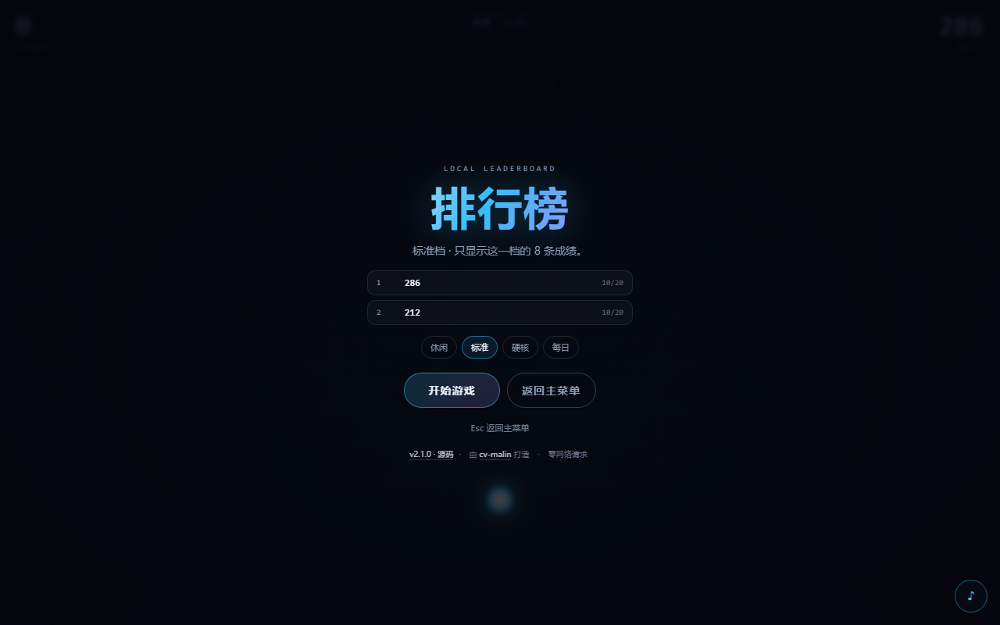
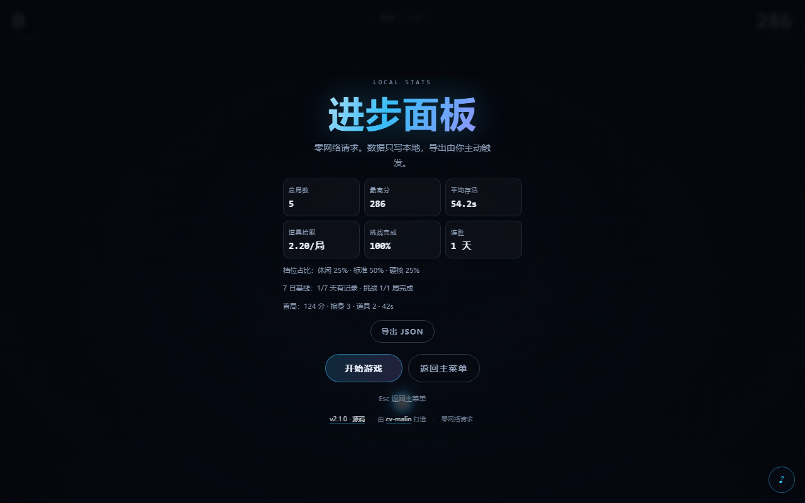

# NEON DODGE · 霓虹躲避

一个零依赖的霓虹风躲避小游戏：在坠落的光柱之间穿行，**擦身而过**会累积连击、分数涨得更快；拾取道具还能护盾、减速、双倍。

v2.1 加了三条让人想再打开的理由：**三档难度**、**每日挑战**、**进步面板**；外加道具磁吸，让新手更容易摸到核心卖点。键盘、鼠标、触屏都能玩，没有构建步骤，没有第三方库。

<p>
  <a href="https://github.com/cv-malin/neon-dodge"></a>
  
  
  <a href="https://cv-malin.github.io/neon-dodge/"></a>
</p>


## 在线试玩

**https://cv-malin.github.io/neon-dodge/**

手机上直接打开也能玩，建议横屏。游戏只在本地读写数据，**零网络请求**；首页的 GitHub 链接只有点击时才会离开游戏。

- 作者：[cv-malin](https://github.com/cv-malin)
- 仓库：[cv-malin/neon-dodge](https://github.com/cv-malin/neon-dodge)
- 许可：MIT

## v2.1 新增

### 1. 三档难度，分档榜单

| 档位 | 系数 | 磁吸 | 适合 |
| :--- | :--- | :--- | :--- |
| 休闲 | 0.8× | 有 | 第一次玩，先活下来 |
| 标准 | 1.0× | 有 | 原汁原味 |
| 硬核 | 1.25× | **无** | 冲高分，没有辅助 |

障碍初速与加速度都按系数缩放，生成概率不变；局中不能切换，选择会记住。每个档位各保留 8 条成绩，互不串榜。

### 2. 每日挑战

- 以 **UTC+8 本地日期** 为种子（`FNV-1a` 哈希），同一天所有设备拿到同一套障碍；
- **固定标准档**，保证可比性；
- **每期只有 1 次**：刷新、关页都算用掉，不接受重试；
- 独立的今日榜；连胜只展示，不影响分数。

### 3. 道具磁吸

道具进入磁吸半径后会以 **3× 下落速度** 靠拢：

```
r(t) = 0.08W + 0.10W · max(0, 1 − t/150)
```

`t` 是局内秒，`W` 是画面宽度。开局半径 0.18W，150 秒后衰减到 0.08W；**硬核档恒为 0**。磁吸只作用于道具，不改变障碍玩法。

### 4. 进步面板

总局数、最高分、平均存活、道具拾取率、档位占比、挑战完成率、7 日基线，一目了然；支持导出带 schema 的 JSON，方便把真实数据贴到 issue 或自己分析。

### 5. 首局引导与成绩卡

- 第一次开局显示 5 秒「← → 移动」，移动即消失，不弹窗、不阻塞；
- 结算可保存 **1080×1440** 霓虹成绩卡 PNG，带 cv-malin / GitHub Pages 标识。

### 6. 数据迁移

自动读取 v1.1 的 `neon-dodge:best` / `:scores` / `:muted`，迁移到 `nd:v2:*`，旧键保留方便回滚；迁移以 `meta.schema` 为闸门，幂等。

## 特性

- **手感**：角色跟随有阻尼，不是生硬的位置赋值；障碍下落速度与刷新频率随距离平滑上升。
- **擦身机制**：贴着障碍边缘擦过去会触发连击，最高 ×9，奖励分数并震动一下镜头。风险越大，收益越高。
- **道具系统**：护盾、减速、双倍三种道具，7~12 秒随机刷新一只，拾取有音效、粒子与触感反馈。
- **本地排行榜**：每档保留最近 8 条成绩，同分先到先得；破纪录会在榜单里高亮。
- **移动端触感**：撞击、擦身、拾取都会触发不同强度的震动（Vibration API，iOS 自动降级）。
- **三种障碍**：单柱、带缺口的双柱（保证永远留出 4.2 倍身位的通道）、横向摆动的移动柱。
- **零依赖**：原生 ES Module + Canvas 2D，没有打包器、没有框架、没有 CDN 资源。
- **自适应**：任意窗口尺寸、devicePixelRatio 缩放、`prefers-reduced-motion` 降级。
- **可复现**：`?seed=42` 固定随机序列，`?auto=1` 进入自动驾驶演示模式。
- **可访问**：键盘可完整操作，`aria-live` 播报分数与状态，音效可关闭。

## 操作

| 输入 | 行为 |
| :--- | :--- |
| `←` `→` / `A` `D` | 左右移动 |
| 鼠标移动 | 角色跟随光标 |
| 触屏拖动 | 手指按住拖动 |
| `空格` / `Enter` | 开始 / 重新开始 |
| `P` / `Esc` | 暂停 / 继续（榜单、统计界面返回菜单） |
| `M` | 静音切换 |

## 道具

| 道具 | 效果 | 时长 |
| :--- | :--- | :--- |
| 🛡 护盾 | 抵挡一次撞击，破碎后获得 1.2 秒无敌（角色闪烁） | 消耗品 |
| ⏳ 减速 | 障碍与场景流速降到 0.55 倍 | 5 秒 |
| ×2 双倍 | 得分翻倍（含擦身奖励） | 6 秒 |

同类道具**刷新时长而不是叠加**——否则连续吃三个减速就能把游戏永久慢放。护盾可以叠在任意效果之上。



## 本地数据

| 键 | 内容 |
| :--- | :--- |
| `nd:v2:meta` | `{schema, migratedFrom, at, lastVisit, visits}` |
| `nd:v2:settings` | 档位、静音、音量、首局引导是否看过 |
| `nd:v2:stats` | 总局数、最高分、存活、拾取、档位占比、分档榜单、每日状态 |
| `nd:v2:events` | 环形缓冲，≤ 500 条；只写本地，不上传 |

事件 schema 见 [docs/PRD.md](docs/PRD.md) 附录 A。`localStorage` 被禁用或写满时自动降级为内存态，仍然可以玩，只是本次数据不保存。



## 本地运行

```bash
git clone https://github.com/cv-malin/neon-dodge.git
cd neon-dodge

# 方式一：内置零依赖静态服务器
node scripts/serve.mjs          # → http://localhost:5173

# 方式二：任意静态服务器，例如
python -m http.server 5173
```

> 不能直接双击 `index.html`：ES Module 在 `file://` 下会被 CORS 拦截。

## 测试

```bash
node --test
```

```
ℹ tests 77
ℹ pass 77
ℹ fail 0
```

覆盖范围：

| 模块 | 断言重点 |
| :--- | :--- |
| `logic.js` | 圆矩碰撞、擦身净距、难度单调、`gate` 缺口 ≥ 4.2r（300 个种子）、自动驾驶落点 |
| `difficulty.js` | 三档系数、初速/加速度缩放、未知档位回退、磁吸开关 |
| `daily.js` | UTC+8 切日、日期 seed 稳定、跨月/闰年、连胜与断档 |
| `magnet.js` | 半径四点边界、硬核恒 0、3× 靠拢、不过冲 |
| `stats.js` | 聚合、分档隔离、每日结算幂等、首局快照、汇总指标 |
| `events.js` | schema、环形缓冲上限、脏数据过滤 |
| `storage.js` | 旧档迁移、幂等、每日 1 次、刷新锁定、写满降级、分榜 |
| `powerups.js` | 刷新不叠加、计时器、时间尺度、分数倍率 |
| `leaderboard.js` | 降序、同分先到先得、上限截断、脏数据过滤 |

## 项目结构

```
neon-dodge/
├── index.html            # 页面骨架 + HUD + 菜单/榜单/统计浮层
├── style.css             # 霓虹主题、难度选择、每日卡、榜单与统计
├── src/
│   ├── main.js           # 启动、主循环、界面状态机、成绩卡
│   ├── game.js           # 玩法与渲染（档位、磁吸、护盾结算）
│   ├── logic.js          # 纯逻辑：碰撞、难度、生成、自动驾驶
│   ├── difficulty.js     # 三档难度定义与缩放
│   ├── daily.js          # UTC+8 日期、日期 seed、连胜
│   ├── magnet.js         # 磁吸半径与靠拢步进
│   ├── stats.js          # 聚合统计、分榜、汇总指标
│   ├── events.js         # 本地事件环形缓冲
│   ├── storage.js        # v2 存储、迁移、每日锁
│   ├── powerups.js       # 道具定义、效果计时、刷新节奏
│   ├── leaderboard.js    # 榜单排序与截断
│   ├── entities.js       # 障碍与粒子
│   ├── input.js          # 键盘 / 鼠标 / 触屏
│   ├── audio.js          # WebAudio 合成音效（无音频文件）
│   ├── haptics.js        # Vibration API 封装
│   └── rng.js            # 可复现随机数
├── docs/PRD.md           # 产品需求文档（v3.0，Google 结构）
├── tests/                # node:test 单元测试（9 个文件 / 77 项）
├── scripts/serve.mjs     # 零依赖静态服务器
└── .github/workflows/    # CI + GitHub Pages
```

## 设计笔记

**固定步长。** 物理更新用 1/120 秒的固定步长累加，渲染跟随 `requestAnimationFrame`。这样 144Hz 和 60Hz 屏幕上手感一致，掉帧时也不会出现「穿模」。

**难度是连续的，档位只缩放速度。** 基础速度从 0.55 屏/秒爬到 1.4 屏/秒，刷新间隔从 0.95 秒压到 0.4 秒，150 屏后封顶。档位只乘在速度上，生成概率保持不变；曲线在 `difficultyAt()` / `applyTier()` 里，是纯函数，可以单测，也可以直接调参。

**公平性优先。** `gate` 形态的缺口由玩家半径推导（≥ 4.2r），不是拍脑袋的像素值；屏幕太窄时会退化成单柱，绝不出零宽障碍。

**擦身判定。** 只在障碍与玩家垂直方向有交叠时计算水平净距，净距 ≤ 2.4r 记为擦身。每个障碍只结算一次，避免「贴着走一路刷分」；连击上限 ×9。

**磁吸是「减少挫败」，不是「自动拾取」。** 只有道具进入半径才生效，且半径随时间衰减；硬核档关闭，保留风险。磁吸不作用于障碍，核心躲避玩法不变。

**每日挑战接受作弊。** 日期 seed 离线可用、零成本；改系统时间可以重开，这是已知取舍。连胜只展示，不作为指标。

**道具刷新而非叠加。** 同类效果取完整时长，避免叠加出无限减速；护盾是布尔量，与计时类效果互不干扰。

**统计先于功能。** 所有聚合都从事件/一局结果推导，面板只读；导出由用户主动触发，对外零上报。

**触感分级。** 撞击是 `45/30/90ms` 的三段震动，擦身是 12ms 的轻点，拾取是 18ms。iOS Safari 不支持 Vibration API，调用处做了存在性判断，静默降级。

**音效全部合成。** 没有 mp3/ogg 资源，振荡器 + 包络就够了，加载为零、体积为零。

## 部署

仓库自带 GitHub Actions：

- `ci.yml`：push / PR 跑 `node --test`；
- `pages.yml`：推送到 `main` 后跑测试，再打包静态文件发布到 Pages。

```yaml
- actions/checkout
- actions/setup-node
- run: node --test
- actions/configure-pages
- actions/upload-pages-artifact
- actions/deploy-pages
```

## 产品文档

- **[PRD（v3.0）](docs/PRD.md)** —— 北极星指标、每日挑战、难度档位、道具磁吸、埋点 schema、发布门禁与回滚方案。
- [CHANGELOG.md](CHANGELOG.md) —— 版本变更记录。

PRD 采用 Google 设计文档结构（Context/Scope、Goals/Non-Goals、Alternatives、Cross-cutting、Launch Gates）。v2.1 先落地 P0（F1–F6）；P1 的成就与分享卡中，分享卡已提前实现，成就留到下一版。

## 路线图

- [x] 三档难度 / 分档榜单
- [x] 每日挑战（UTC+8 seed、每日 1 次）
- [x] 道具磁吸与统计面板
- [x] 首局引导与 1080×1440 成绩卡
- [ ] 8 条成就
- [ ] PWA 离线与中英双语
- [ ] Gamepad 支持

## 许可

[MIT](LICENSE) © 2026 cv-malin
