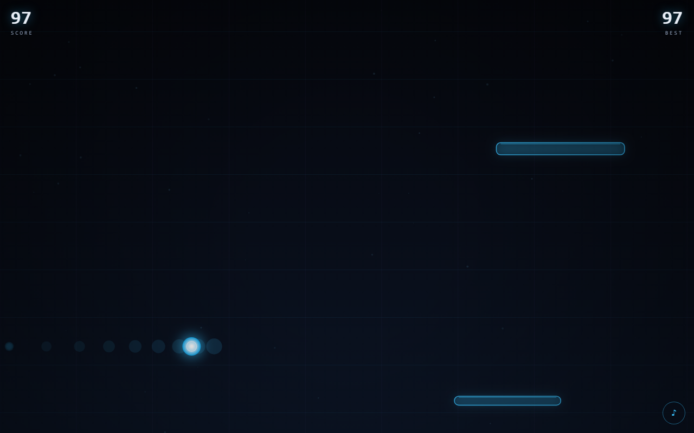

# NEON DODGE · 霓虹躲避

一个零依赖的霓虹风躲避小游戏：在坠落的光柱之间穿行，**擦身而过**会累积连击、分数涨得更快。

键盘、鼠标、触屏都能玩；没有构建步骤，没有第三方库，一个 HTML 文件就能跑起来。

<p>
  <a href="https://github.com/cv-malin/neon-dodge"></a>
  
  
  <a href="https://cv-malin.github.io/neon-dodge/"></a>
</p>



## 在线试玩

**https://cv-malin.github.io/neon-dodge/**

手机上直接打开也能玩，建议横屏。

## 特性

- **手感**：角色跟随有阻尼，不是生硬的位置赋值；障碍下落速度与刷新频率随距离平滑上升。
- **擦身机制**：贴着障碍边缘擦过去会触发连击，最高 ×9，奖励分数并震动一下镜头。风险越大，收益越高。
- **三种障碍**：单柱、带缺口的双柱（保证永远留出 4.2 倍身位的通道）、横向摆动的移动柱。
- **零依赖**：原生 ES Module + Canvas 2D，没有打包器、没有框架、没有 CDN 资源。
- **自适应**：任意窗口尺寸、devicePixelRatio 缩放、`prefers-reduced-motion` 降级。
- **可复现**：`?seed=42` 固定随机序列，`?auto=1` 进入自动驾驶演示模式。
- **有测试**：碰撞、擦身判定、难度曲线、障碍生成的不变量都有单元测试。
- **可访问**：键盘可完整操作，`aria-live` 播报分数，音效可关闭。

## 操作

| 输入 | 行为 |
| :--- | :--- |
| `←` `→` / `A` `D` | 左右移动 |
| 鼠标移动 | 角色跟随光标 |
| 触屏拖动 | 手指按住拖动 |
| `空格` / `Enter` | 开始 / 重新开始 |
| `P` / `Esc` | 暂停 / 继续 |
| `M` | 静音切换 |

## 本地运行

```bash
git clone https://github.com/cv-malin/neon-dodge.git
cd neon-dodge

# 方式一：内置零依赖静态服务器
node scripts/serve.mjs          # → http://localhost:5173

# 方式二：任意静态服务器，例如
python -m http.server 5173
```

> 不能直接双击 `index.html`：ES Module 在 `file://` 下会被 CORS 拦截。

## 测试

```bash
node --test
```

```
✔ clamp 边界
✔ 圆与矩形碰撞
✔ 水平净距
✔ 擦身判定只看垂直交叠
✔ 难度随距离单调变化
✔ gate 形态永远留出可通行缺口
✔ zig 形态在场地内往复
✔ 自动驾驶选择的落点在场地内且远离障碍
✔ 自动驾驶没有威胁时保持居中偏置
ℹ pass 9  fail 0
```

最难测的是"生成器永远不堵死路"。`gate` 形态会在 300 个随机种子下断言：柱子不越界、宽度非负、最大缺口 ≥ 4.2 倍玩家半径。

## 项目结构

```
neon-dodge/
├── index.html            # 页面骨架 + HUD + 三层浮层
├── style.css             # 霓虹主题、响应式布局
├── src/
│   ├── main.js           # 启动、主循环（固定步长）、状态机
│   ├── game.js           # 玩法与渲染
│   ├── logic.js          # 纯逻辑：碰撞、难度、生成、自动驾驶
│   ├── entities.js       # 障碍与粒子
│   ├── input.js          # 键盘 / 鼠标 / 触屏
│   ├── audio.js          # WebAudio 合成音效（无音频文件）
│   ├── rng.js            # 可复现随机数
│   └── storage.js        # 最高分持久化
├── tests/logic.test.mjs  # node:test 单元测试
├── scripts/serve.mjs     # 零依赖静态服务器
└── .github/workflows/pages.yml
```

## 设计笔记

**固定步长。** 物理更新用 1/120 秒的固定步长累加，渲染跟随 `requestAnimationFrame`。这样 144Hz 和 60Hz 屏幕上手感一致，掉帧时也不会出现"穿模"。

**难度是连续的。** 速度从 0.55 屏/秒爬到 1.4 屏/秒，刷新间隔从 0.95 秒压到 0.4 秒，150 屏后封顶。曲线在 `difficultyAt()` 里，是纯函数，所以可以单测，也可以直接调参。

**公平性优先。** `gate` 形态的缺口由玩家半径推导（≥ 4.2r），不是拍脑袋的像素值；屏幕太窄时会退化成单柱，绝不出零宽障碍。

**擦身判定。** 只在障碍与玩家垂直方向有交叠时计算水平净距，净距 ≤ 2.4r 记为擦身。每个障碍只结算一次，避免"贴着走一路刷分"。

**音效全部合成。** 没有 mp3/ogg 资源，振荡器 + 包络就够了，加载为零、体积为零。

## 部署

仓库自带 GitHub Pages 工作流，推送到 `main` 即自动发布：

```yaml
# .github/workflows/pages.yml
- actions/configure-pages
- actions/upload-pages-artifact   # 只打包静态文件
- actions/deploy-pages
```

## 路线图

- [ ] 排行榜（可选后端，或纯本地记录）
- [ ] 道具：护盾、减速、磁吸
- [ ] 震动反馈（Gamepad / Vibration API）
- [ ] 用 OffscreenCanvas + Worker 把渲染挪出主线程

## 许可

[MIT](LICENSE) © 2026 cv-malin
